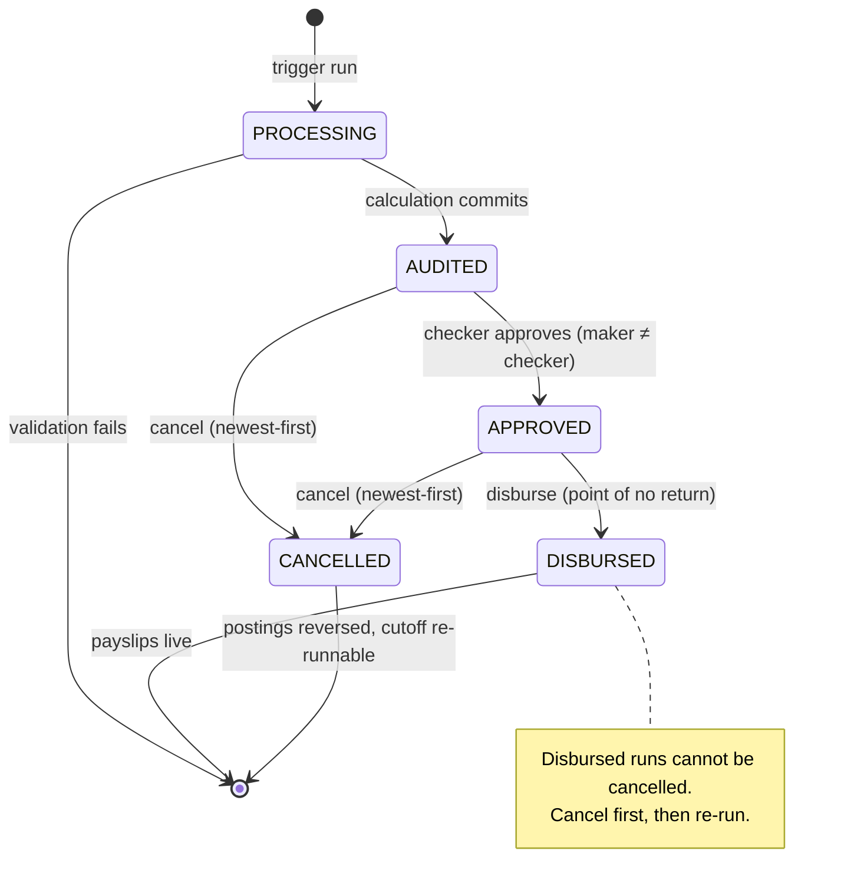
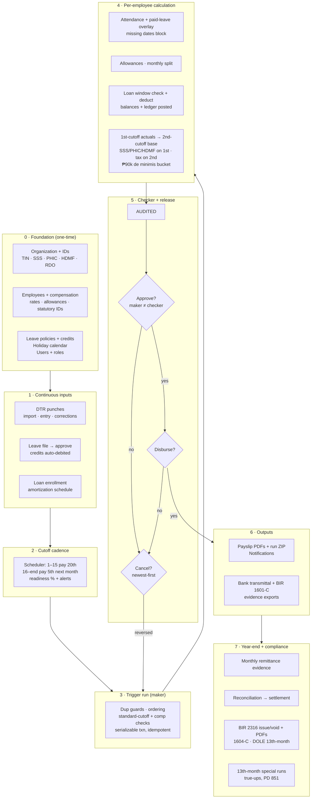

# Payroll workflow

How money moves from setup to payslips in this system. All paths below are
enforced in code, not convention — see the referenced sources.

## Run lifecycle

Transitions: `APPROVE` only from `AUDITED`, `DISBURSE` only from `APPROVED`,
`CANCEL` from `DRAFT`/`PROCESSING`/`AUDITED`/`APPROVED`
(`apps/api/src/modules/payroll/payroll.service.ts:62`).
Conditional writes make concurrent transitions conflict instead of
double-applying (`payroll.service.ts:273`, `payroll.service.ts:309`).

## End-to-end flow

## Stage details

### 0 · Foundation
Organization record, branches, departments, employees with compensation
profiles, allowances, leave policies/credits, holiday calendar, and role
assignments. Human operators are linked employee records; only the bootstrap
system account stays unlinked.

### 1 · Continuous inputs
- **DTR**: biometric CSV import with anomaly detection, manual entry, and
  audited corrections (`timekeeping.service.ts`). Missing dates are never
  invented — every weekday needs an explicit approved record.
- **Leaves**: file → department-scoped approve/reject → credits debited;
  withdraw, HR cancel-approved, SIL monetization, accrual/carryover.
- **Loans**: enrollment with amortization terms; balances never negative.

### 2 · Cutoff cadence
Semi-monthly periods derived in Asia/Manila civil time
(`cutoff-scheduler.service.ts:47`). Readiness score blends run state, punch
anomalies, and pending leaves; alerts name exactly what blocks the run.

### 3 · Trigger (maker)
`executePayrollRun` (`payroll.service.ts:494`): duplicate-month guards,
first/second ordering rules, full-standard-cutoff shape for monthly pay,
compensation-profile presence — all inside a serializable transaction with
retry and an idempotency key, so replays return the existing run.

### 4 · Calculation
Per active employee: approved attendance with paid-leave overlay, allowance
resolution, loan eligibility and posting, second-cutoff tax base read from
actual first-cutoff payslips, YTD ₱90,000 de minimis bucket, then
`calculatePhilippinePayroll` (SSS/PhilHealth/Pag-IBIG on 1st cutoff,
withholding tax on 2nd). Any unresolvable state aborts that employee with a
named error — never a guessed number.

### 5 · Checker and release
Approve (different user enforced), disburse (irreversible), or cancel with
full reversal of loans, payments, payslips, and the run row. Every transition
is audit-logged and notifies the right audience (approvers, payroll staff,
all users on disbursement).

### 6 · Outputs
Payslip PDFs, run ZIP, self-service payslips, bank transmittal and BIR 1601-C
evidence exports.

### 7 · Year-end and compliance
Versioned monthly remittance evidence, reconciliation preview, settlement
recording, BIR 2316 issuance/voiding with PDFs, 1604-C alphalist, DOLE
13th-month report, 13th-month true-up runs, and reviewed tax corrections.

## Invariants (hold at every stage)

- Tenant isolation on every query (`organizationId` scoping).
- Role enforcement in API and UI for all five roles.
- No silent money movement: no invented attendance, no estimated tax base,
  no over-collection, no self-approval, no post-disbursement edits.
